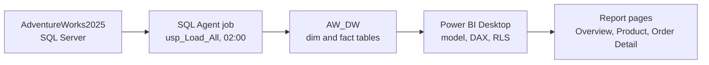
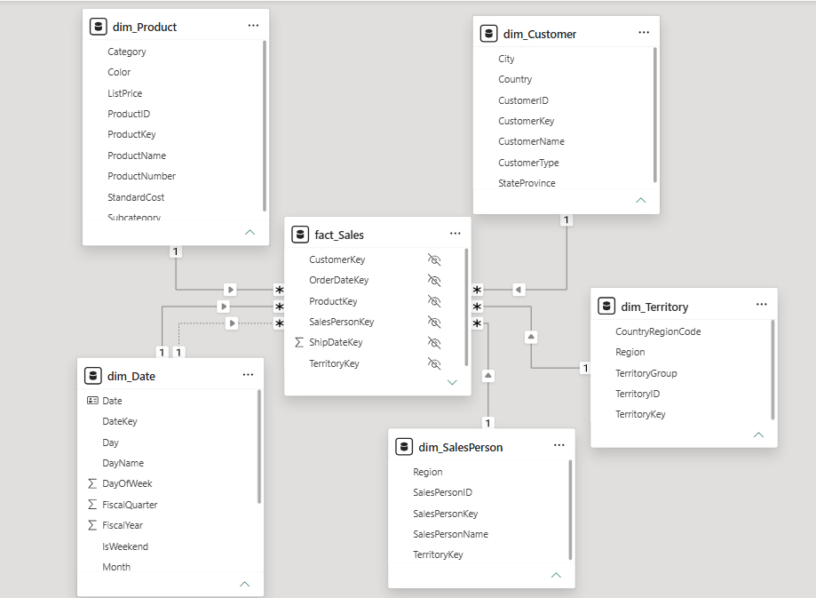

# AdventureWorks BI Project

An end-to-end business intelligence solution: a SQL Server star schema, scheduled
loads with SQL Server Agent, and a Power BI report with DAX measures, drill-through
and row-level security.

## Architecture

Azure Data Factory was in the original brief. It was replaced by SQL Server Agent
because no Azure access was available.

## Star schema

Grain of `fact.Sales`: one row per sales order line (121,317 rows). Dimensions:
Date, Product, Customer, Territory, SalesPerson. See `docs/data_dictionary.md`.

## Prerequisites
- SQL Server 2025 (or 2022) and SSMS
- Power BI Desktop (Windows)
- The AdventureWorks2025 OLTP backup restored as `AdventureWorks2025`

## Setup
1. Run the scripts in `sql/` in numbered order (01 to 10) in SSMS.
2. Run `EXEC AW_DW.dbo.usp_Load_All;` to load the warehouse.
3. Open `powerbi/AdventureWorks_BI.pbix`.
4. Home > Transform data > Data source settings: set the server to your instance
   (the project used `localhost\MSSQLSERVER02`) and the database to `AW_DW`.
5. Click Home > Refresh.

## Results
- 121,317 order lines loaded. Revenue reconciles to the source within 0.025.
- ETL runs in 2 to 12 seconds. A Desktop refresh takes about 10 seconds.
- DAX: Sales, Cost, Profit, Margin %, YTD, prior year, YoY %, rolling 3-month average.
- Row-level security tested for two regional managers and an executive role.
- See `tests/` for reconciliation, ETL, DAX, RLS and performance evidence.

## Challenges
- A reconciliation check exposed a modelling error in dim.Customer: store customers
  were labelled as individuals. Fixed in place so surrogate keys stayed stable.
- Source data starts mid-2022 and thins out in May and June 2025, so year-over-year
  comparisons needed a "comparable period" measure.
- Revenue differs from the source by 0.025 because of decimal precision (rounding).

## Known limitations
- Power BI Service publishing and scheduled cloud refresh were not done: no work or
  school account was available (see `docs/service_deployment_plan.md`).
- The host laptop must be on for the scheduled load to run.
- ExtendedCost uses current StandardCost, not the cost at the time of sale.
- Data ends on 29 June 2025.

## Next steps
Add Azure Data Factory with watermark-based incremental loads, use ProductCostHistory
for accurate cost, track product price history (SCD Type 2), and deploy to the
Power BI Service with a gateway and scheduled refresh.

## Documentation
- `docs/User_Guide.md`
- `docs/data_dictionary.md`
- `docs/service_deployment_plan.md`
- `tests/` (reconciliation, ETL, DAX, RLS, performance)
